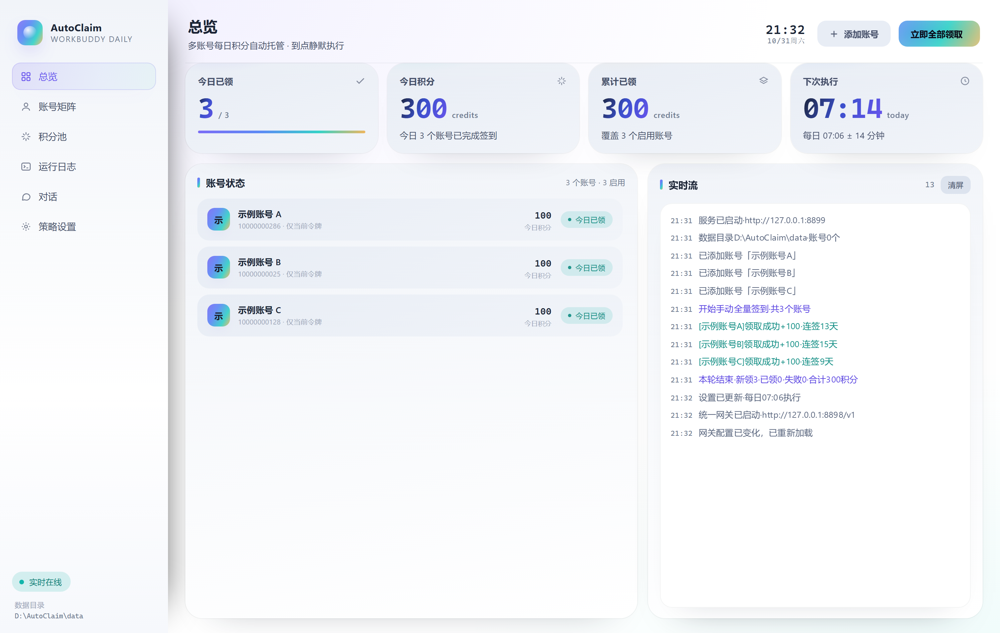
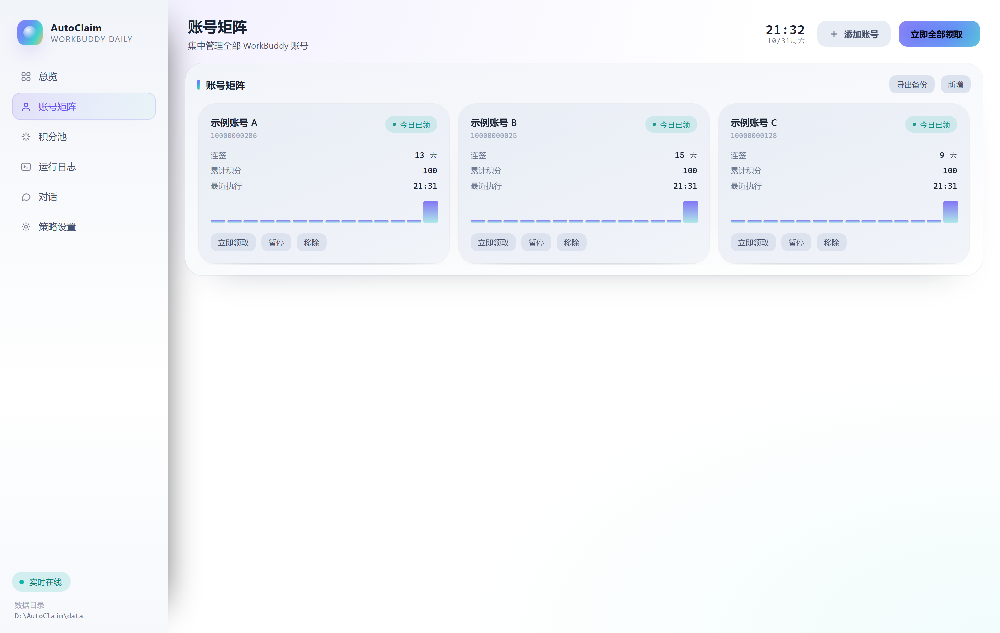
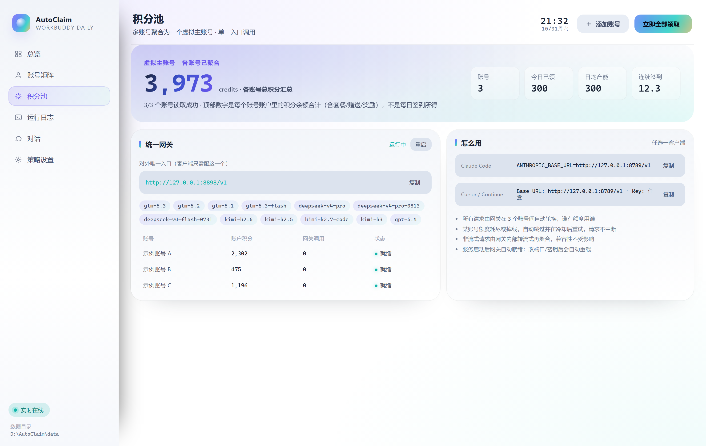

<div align="center">


# AutoClaim

**WorkBuddy 多账号每日积分托管 · 零依赖 · 本地优先**

把一个或多个账号的每日免费额度自动领完，并把所有账号聚合成一个 OpenAI 兼容端点对外服务。

[](LICENSE)
[](https://nodejs.org)
[]()
[]()

</div>

---

## 这是什么

AutoClaim 是一个跑在你自己机器上的小服务，由三部分组成：

| 组件 | 作用 |
| --- | --- |
| **面板** `:8788` | 网页界面：账号管理、实时日志、积分池总览、一键领取 |
| **调度器** | 每天固定时刻（默认 00:05 + 随机延迟）自动领取，启动时补领漏掉的 |
| **统一网关** `:8789` | OpenAI 兼容端点，多账号令牌自动轮换，一个地址用完全部额度 |

只用 Node.js 内置模块，**没有第三方运行时依赖**，也不需要数据库：所有状态落在 `./data`。

---

## 界面预览

| 总览 | 账号矩阵 |
| --- | --- |
|  |  |

**积分池 · 多账号聚合成一个虚拟主账号**



> 截图使用演示账号 + 本地模拟接口生成，不含任何真实账号数据。

---

## 特性

- **幂等 + 补领**：先查签到状态再决定是否领，重复执行安全；关机错过时间点，开机立刻补上。
- **零依赖**：`node server.js` 即跑，无需 `npm install`。
- **凭据本地加密**：账号凭据用 AES-256-GCM 加密存 `data/vault.enc`，密钥独立存放。
- **令牌自动续期**：有 `refreshToken` 时临期自动刷新；也支持 Keycloak Cookie 会话模式。
- **多账号统一网关**：`/v1/chat/completions` 对外单一端点，内部按额度健康度选号，401/429 自动冷却换号。
- **单文件可执行**：Node SEA 打包成 ~87 MB 的 `WB-AutoClaim.exe`，双击即用，无需装 Node。
- **Windows 友好**：`install.bat` 注册开机自启 + 桌面快捷方式；也支持 Docker / systemd 常驻。

---

## 快速开始

### 方式一：源码运行（推荐开发用）

```bash
git clone https://github.com/007wuzhaokang/WB-AutoClaim.git
cd WB-AutoClaim
node server.js          # 或 npm start
```

打开 <http://127.0.0.1:8788>。

Windows 上也可直接双击 `start.bat`（带守护循环，进程退出 5 秒后自动重启），
或 `install.bat` 注册开机自启并生成桌面快捷方式。

### 方式二：单文件 exe（Windows 免环境）

从 [Releases](../../releases) 下载 `WB-AutoClaim.exe`，放到任意可写目录双击运行。
数据目录固定在 exe 同级的 `data/`，换目录 = 换一套账号，迁移时连 `data/` 一起拷。

### 方式三：Docker / 服务器常驻

```bash
docker compose up -d          # 已把 ./data 挂成持久卷
```

不用 Docker 的话，systemd 单元示例：

```ini
[Unit]
Description=AutoClaim
After=network-online.target

[Service]
WorkingDirectory=/opt/WB-AutoClaim
ExecStart=/usr/bin/node server.js
Restart=always
RestartSec=5

[Install]
WantedBy=multi-user.target
```

> 面板默认只监听 `127.0.0.1`。要远程访问请加反向代理 + Basic Auth，**不要**直接把 8788 暴露到公网。

---

## 添加账号

### 方式 A：粘贴 cURL（最简单）

1. 浏览器登录 <https://www.workbuddy.cn>
2. `F12` → **Network** → 随便点一个站内请求
3. 右键该请求 → **Copy** → **Copy as cURL (bash)**
4. 面板右上角「添加账号」→ 整段粘贴 → 「添加并测试」

会自动识别 `Authorization`、`X-User-Id`、`X-Refresh-Token`、`X-Device-Token`、
`X-Enterprise-Id`、`Cookie`、接口域名。

### 方式 B：手动填字段

| 字段 | 说明 |
| --- | --- |
| `accessToken` | Bearer 令牌 |
| `uid` | `X-User-Id` |
| `refreshToken` | 可选，但有它才能到期自动续期 |
| `cookie` | 走 Cookie 会话模式时必填（需包含 `KEYCLOAK_IDENTITY` 等完整会话） |
| `userAgent` | Cookie 模式下**必须**与抓包时浏览器的 UA 完全一致，否则 401 |

> **Cookie 模式的坑**：网关以 HttpOnly Cookie 鉴权，且 Cookie 与 User-Agent 强绑定。
> 直接拷 `document.cookie` 是不完整的（拿不到 HttpOnly 项），必须从 DevTools 的请求头里整段复制。
> 若不想折腾，优先用方式 A 让工具自动抓全。

---

## 执行逻辑

```
每日 claimTime（默认 00:05，随机延迟 0~14 分钟）
        │
        ├─ 令牌临期 → POST /v2/auth/token/refresh
        ├─ 查状态   → POST /v2/billing/meter/checkin-status
        │      已领 → 记「今日已领」，跳过
        └─ 领取     → POST /v2/billing/meter/daily-checkin
                失败 → 最多重试 3 次（间隔 45s）
```

- **不靠 7×24 运转**，靠幂等 + 补领：服务启动时若发现今天还有账号没领，立即补领（可在设置里关掉）。
- 多账号之间间隔 0.9~2.3 秒串行请求，避免被风控当成批处理。
- 积分池显示的是**各账号当前总积分之和**（`get-user-resource-summary` 的 `TotalCredits`），不是历史签到累加。

---

## 统一网关：把多账号合成一个端点

官方没有积分转账接口，积分无法真正搬到同一个账号，但可以被令牌消耗。
所以网关做的是「**对外一个地址，对内轮流用号**」——效果等价于所有积分合成一个主账号，
客户端只需配置一次、永不切换。

```bash
Base URL : http://127.0.0.1:8789/v1
Models   : GET  http://127.0.0.1:8789/v1/models
Chat     : POST http://127.0.0.1:8789/v1/chat/completions   # stream / 非 stream 均可
Health   : GET  http://127.0.0.1:8789/health
```

- 非流式请求由网关内部转流式再聚合，兼容性不受影响。
- 请求级错误（如模型不存在）快速失败、不惩罚账号；账号级错误（401/429/额度耗尽）换号并指数退避冷却。
- 改端口 / 密钥 / 开关后网关自动重载。

实测可用的模型（以账号实际权限为准）：
`glm-5.3` `glm-5.2` `glm-5.1` `glm-5.3-flash` `deepseek-v4-pro` `deepseek-v4-pro-0813`
`deepseek-v4-flash-0731` `kimi-k2.6` `kimi-k2.5` `kimi-k2.7-code` `kimi-k3` `gpt-5.4`

---

## 数据与安全

| 文件 | 内容 |
| --- | --- |
| `data/vault.enc` | 账号凭据，AES-256-GCM 加密 |
| `data/vault.key` | 本地密钥（与密文分开存放） |
| `data/config.json` | 非敏感策略配置 |
| `data/runs.jsonl` | 执行流水（只记结果，不含令牌） |

- 服务默认只监听 `127.0.0.1`，外网不可达。
- 令牌只用于调用官方接口，不上传任何第三方。
- `data/` 已在 `.gitignore` 中，**永远不会被提交**。提交前请再确认一次 `git status`。
- 换机迁移：连同 `vault.key` 一起复制，或使用面板的「导出备份」。

---

## 设置项

| 项 | 默认 | 说明 |
| --- | --- | --- |
| 每日执行时刻 | `00:05` | 跨过零点即可领当天额度 |
| 随机延迟 | 14 分钟 | 同刻集中请求容易触发风控 |
| 失败重试 | 3 次 | 网络抖动兜底 |
| 面板端口 | 8788 | 仅本机监听 |
| 网关端口 | 8789 | OpenAI 兼容端点 |
| API 节点 | `https://www.workbuddy.cn` | 企业私有域名可改 |

---

## 从源码构建单文件 exe

```bash
bash build-exe.sh      # 需 Node 18+，Windows 需 rcedit（脚本会自动准备）
```

流程：`gen-inline.cjs` 把前端 base64 内联 → `esbuild` 打成单 CJS → `node --experimental-sea-config`
生成 blob → 复制 node.exe → `rcedit` 写入图标/版本信息 → `postject` 注入。
产物在 `dist/`。

---

## 项目结构

```
server.js          主服务：路由 / 调度 / 凭据库 / 积分接口
gateway.js         OpenAI 兼容网关（多账号轮换与冷却）
browser-login.js   CDP 登录助手：拉起浏览器、抓 Cookie 与 UA
public/            前端（原生 HTML/CSS/JS，无框架）
  index.html
  app.js
  style.css
tools/             探针脚本（调试接口、余额、图标、快捷方式）
build-exe.sh       单文件打包流水线
*.bat              Windows 启动 / 安装 / 卸载
```

### 常用 API

| 方法 | 路径 | 说明 |
| --- | --- | --- |
| GET | `/api/state` | 账号与设置（已脱敏） |
| GET | `/api/logs` | 运行日志 |
| GET | `/api/events` | SSE 实时推送 |
| POST | `/api/accounts` | 添加账号（`raw` 传 cURL 或字段） |
| POST | `/api/accounts/:id/claim` | 单账号立即领取 |
| POST | `/api/claim-all` | 全部立即领取 |
| GET | `/api/credits` | 积分池总览（各账号余额汇总） |
| GET/POST | `/api/gateway` | 网关状态 / 重置 |
| POST | `/api/settings` | 修改设置 |
| GET/POST | `/api/export` `/api/import` | 加密备份导出 / 导入 |

---

## 常见状态

| 状态 | 含义 | 处理 |
| --- | --- | --- |
| 今日已领 | 接口返回已签到 | 无需操作 |
| 需授权 | 401，令牌失效且无 refreshToken | 重新粘贴 cURL |
| 待重试 | 网络 / 接口异常 | 服务会自动重试，持续失败看日志原文 |
| 待执行 | 今天还没跑 | 到点自动执行，或点「立即领取」 |

鉴权类问题直接看「运行日志」里的接口原始返回，比猜快得多。

---

## 免责声明

本项目仅用于**管理你自己的账号**、减少重复点击，不含任何绕过付费或提权的实现。
使用前请自行确认符合你所处环境的服务条款；由使用行为产生的一切后果由使用者承担。

## License

[MIT](LICENSE)
